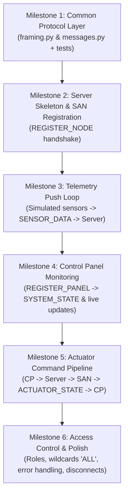

Here is the complete overview of the plan, taking into account your choices: **raw TCP sockets**, **`asyncio` concurrency**, and **idiomatic Python module organization**.

---

### 1. Target Project Architecture

All source code lives under `src/smart_home_automation/`:

```text
src/smart_home_automation/
├── __init__.py
│
├── common/                  # Shared protocol logic across all components
│   ├── __init__.py          # Re-exports common tools for clean imports
│   ├── constants.py         # Port 5555, ErrorCode, Role, MessageType, etc. (DONE)
│   ├── framing.py           # Raw TCP byte/NDJSON encode/decode (splits on '\n')
│   └── messages.py          # Message building, validation, and schema checks
│
├── server/                  # The Central Hub (Port 5555)
│   ├── __init__.py          # Entry point for 'uv run server'
│   ├── server.py            # asyncio.start_server listener & connection loop
│   ├── state.py             # In-memory store of connected SANs, sensors, actuators
│   └── router.py            # Routes commands, checks roles (OWNER vs GUEST), broadcasts
│
├── node/                    # Sensor-Actuator Node (SAN)
│   ├── __init__.py          # Entry point for 'uv run sensor'
│   ├── node.py              # SAN client: connects, registers, sends telemetry, handles cmds
│   ├── sensors.py           # Base Sensor + Temp, Door, Humidity + create_sensor() factory
│   └── actuators.py         # Base Actuator + Fan, Heater, Lock + create_actuator() factory
│
└── control_panel/           # Control Panel (CP)
    ├── __init__.py          # Entry point for 'uv run control_panel'
    ├── client.py            # CP client: connects, receives live updates, sends commands
    └── ui.py                # Command-line interface or text UI (visualizes data & menu)
```

---

### 2. Step-by-Step Implementation Roadmap

Break the work down into incremental milestones where each step is testable before moving to the next:



#### Milestone 1: Shared Protocol Layer (`common/`)
*Focus: Get data into and out of bytes reliably without networking.*
- **`framing.py`**:
    - Functions to encode a dictionary into bytes ending with `\n` (`b'{"type": ...}\n'`).
    - Helper to decode incoming bytes from `readline()` back into a Python dict.
- **`messages.py`**:
    - Validation functions: checking required fields according to [protocol.md](file:///Users/sondrelassen/Library/CloudStorage/GoogleDrive-sondrelassen@gmail.com/My%20Drive/Studie/3.%20Semester/Nettverk/Gruppeprosjekt/IDATA2304-SmartHome-Automation/protocol.md) (e.g. `REGISTER_NODE` must contain `node_id`, `sensors`, `actuators`).
    - Standard error message builder (`ERR_INVALID_SCHEMA`, `ERR_MALFORMED_JSON`).
- **Unit Tests**: Write tests in `src/tests/` to verify framing and schema validation without needing any running server.

#### Milestone 2: Server Skeleton & SAN Handshake
*Focus: First successful TCP socket communication.*
- **`server/`**:
    - Start an `asyncio.start_server` listening on `DEFAULT_PORT` (5555).
    - Accept connection, read first line using `await reader.readline()`.
- **`node/`**:
    - `node.py` connects with `asyncio.open_connection("127.0.0.1", 5555)`.
    - Sends `REGISTER_NODE` with its sensor and actuator manifest.
- **Verification**: Server logs `"Node living_room_01 registered with 2 sensors and 1 actuator"`.

#### Milestone 3: Sensors & Telemetry Push
*Focus: Data flowing from SAN to Server.*
- **`node/sensors.py`**:
    - `Sensor` base class and concrete implementations (`TemperatureSensor`, etc.).
    - Factory function `create_sensor()`.
- **`node/node.py`**:
    - Background async loop: periodically (e.g., every 5 seconds) reads sensor values and sends `SENSOR_DATA` to the server.
- **`server/state.py`**:
    - Server updates its cached state whenever `SENSOR_DATA` arrives.

#### Milestone 4: Control Panel Connection & Monitoring
*Focus: Data flowing from Server to CP.*
- **`control_panel/client.py`**:
    - Connects to server, sends `REGISTER_PANEL` (with role, e.g. `OWNER`).
- **`server/router.py`**:
    - On registration, server replies with `SYSTEM_STATE` (snapshot of all current nodes/sensors).
    - When `SENSOR_DATA` arrives from any node, server broadcasts it to all connected CPs.
- **`control_panel/ui.py`**:
    - Simple CLI menu displaying incoming sensor data in real time.

#### Milestone 5: Actuator Control Pipeline
*Focus: Full round-trip command execution.*
- **`node/actuators.py`**:
    - `Actuator` base class and implementations (`FanActuator`, `HeaterActuator`) with state (`ON`, `OFF`).
- **Command flow**:
    1. User selects "Turn fan on" in Control Panel $\rightarrow$ sends `ACTUATOR_CMD`.
    2. Server verifies target node exists $\rightarrow$ forwards command to that node's socket.
    3. Node updates actuator state $\rightarrow$ sends `ACTUATOR_STATE` confirmation to Server.
    4. Server updates state cache $\rightarrow$ broadcasts `ACTUATOR_STATE` to all Control Panels.

#### Milestone 6: Security, Wildcards, and Fault Tolerance
*Focus: Meeting the grade criteria and assignment details.*
- Role-based authorization (`GUEST` cannot control critical actuators $\rightarrow$ send `ERR_AUTH_FAILED`).
- Wildcard support (`target_node_id: "ALL"` dispatches commands to all connected nodes).
- Handle abrupt disconnects (client closes socket $\rightarrow$ server marks node offline and notifies CPs).

---

### 3. Current Status & Next Immediate Step

- **Completed**:
    - Protocol specification: [protocol.md](file:///Users/sondrelassen/Library/CloudStorage/GoogleDrive-sondrelassen@gmail.com/My%20Drive/Studie/3.%20Semester/Nettverk/Gruppeprosjekt/IDATA2304-SmartHome-Automation/protocol.md).
    - Constants & Enums: [constants.py](file:///Users/sondrelassen/Library/CloudStorage/GoogleDrive-sondrelassen@gmail.com/My%20Drive/Studie/3.%20Semester/Nettverk/Gruppeprosjekt/IDATA2304-SmartHome-Automation/src/smart_home_automation/common/constants.py).
    - Concurrency decision: Built-in `asyncio` TCP streams.
- **Next Step (Milestone 1)**:
    - Create `src/smart_home_automation/common/framing.py` to handle converting Python `dict`s to/from newline-terminated JSON bytes over sockets.